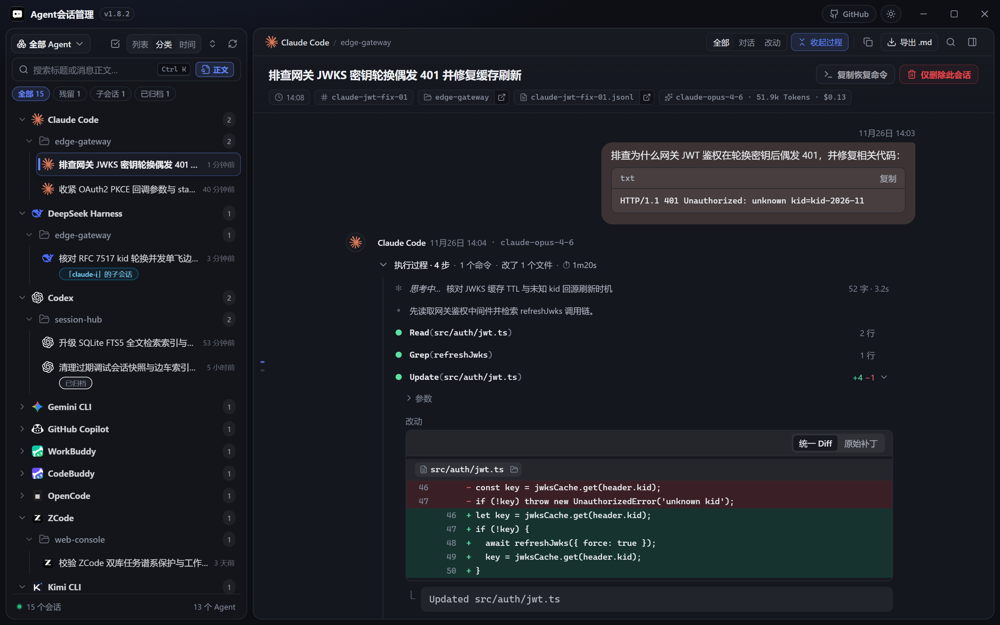
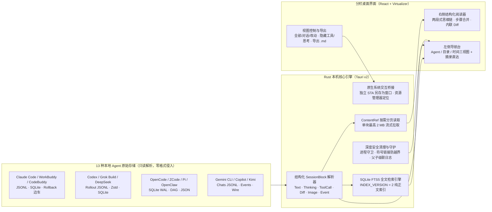

<div align="center">


# Agent会话管理

**面向 13 种本地编码 Agent 的一站式桌面会话浏览、结构化阅读、全文检索与安全清理工具**

<sub>Standalone desktop session manager for local coding agents — browse, full-text search, inspect chain-of-thought & diffs, export Markdown, and safely clean up Codex, Claude Code, Gemini CLI, GitHub Copilot, DeepSeek Harness, WorkBuddy, CodeBuddy, Kimi CLI, OpenClaw, OpenCode, ZCode, Pi and Grok Build sessions on Windows and Linux.</sub>

[](https://github.com/zhuchongba-01/AgentSessionManager/releases)
[](./LICENSE)
[](https://github.com/zhuchongba-01/AgentSessionManager/releases)

<br/>

<picture>
  <source media="(prefers-color-scheme: dark)" srcset="docs/images/main-window-dark.png" />
  <source media="(prefers-color-scheme: light)" srcset="docs/images/main-window-light.png" />
  
</picture>

*主界面（随 GitHub 亮 / 暗外观自动切换）：左侧按 Agent / 项目 / 时间分组的会话列表（支持跨会话正文 FTS5 检索与状态快筛），中间轮次缩略导航，右侧两段式思维链、步骤合并、内联行号 Diff 阅读器与操作面板。*

</div>

---

## ✨ 主要特性

- 🔍 **十三种编码 Agent，一站式纳管**：原生解析 **Codex、Claude Code、Gemini CLI、GitHub Copilot、DeepSeek Harness、WorkBuddy、CodeBuddy、Kimi CLI、OpenClaw、OpenCode、ZCode、Pi、Grok Build** 的本地会话记录、父子代理谱系与项目目录绑定。
- 🧠 **两段式思维链与结构化阅读引擎**：
  - 按各 Agent 原生视觉风格呈现推理块（`✻ 思考中…` / `• 推理` / `✦ 想法` / `Thought` / `Thinking…`），默认单行展示摘要、字数与耗时，点击展开预览并可经 `ContentRef` 按需分页拉取最高 2 MB 完整推理正文；加密推理块静态标识「思考内容不可见」。
  - 工具栏支持一键 **`✻ 隐藏思考 / 显示思考`** 与 **`🔧 隐藏工具 / 显示工具`**，实时过滤画面并自动同步到复制与 `.md` 导出。
- 🛠️ **工具配对、连续步骤合并与内联 Diff 补丁**：
  - 按 `callId` 精确配对工具调用与返回结果，自动将连续读文件/搜索折叠为 `Explored · 查看了 X 个文件、搜索 Y 次`，同服务连续 MCP 调用折叠为 `Called {server} N times`；失败命令在折叠态下自动置顶常显。
  - 文件编辑/写入内置行号着色的 **`统一 Diff | 原始补丁`** 视图，并支持 **`全部 | 对话 | 改动`** 三态专注筛选与 **`展开过程 / 收起过程`** 全局控制。
- ⚡ **跨会话正文全文检索（SQLite FTS5）**：开启搜索框右侧「正文」开关即可在后台增量构建本地 SQLite FTS5（`trigram` + 短词，`INDEX_VERSION = 2` 仅索引非注入正文）索引，展示高亮摘录卡片并一键跳转到目标轮次对应行；关闭开关立即彻底删除索引文件。
- 📤 **原生「另存为」导出 `.md`、路径胶囊定位与恢复命令**：
  - 点击 **`导出 .md`** 弹出系统原生保存对话框（Windows 端在独立 STA 线程调用 COM `IFileSaveDialog`），由用户自由选择保存目录与文件名。
  - 对话中的本地路径自动渲染为 **`[📄 相对路径 | 📂]`** 胶囊，支持一键复制路径或在系统文件管理器中精准定位（支持 `~` 展开、剥离 `:行号` 后缀及已删子路径回退父目录）；支持一键复制包含工作目录切换的跨平台会话恢复命令。
- 🧭 **双模会话导航与精致桌面体验**：同时提供左侧轮次缩略导航条（悬停预览问答摘要）与右侧可展开「对话目录」抽屉（按提问/回复/章节跳转），配备无箭头悬浮胶囊滚动条与亮色 / 暗色 / 跟随系统三态主题。
- 🧹 **深度安全清理**：内置进程运行守卫、NTFS 重解析点 / 符号链接防越界校验、子会话「先子后父」级联清理、50+ 条批量知情核对与崩溃可恢复的待清理日志，绝不触碰用户项目工作目录。详细安全边界见 [SAFETY.md](./SAFETY.md)。

---

## 🧭 核心架构



---

## 🗂️ 支持的 Agent 与会话位置

<details open>
<summary><b>查看全部 13 种 Agent 的本地扫描路径与环境变量覆盖规则</b> <sub>（点击折叠 / 展开）</sub></summary>

| Agent | 会话数据位置与环境变量覆盖 |
| --- | --- |
| **Codex** | `~/.codex`（`sessions/`、`archived_sessions/` JSONL/Zstd、`config.toml`、`state_*.sqlite`、`thread_history_*.sqlite`），可用 `CODEX_HOME`、`CODEX_SQLITE_HOME` 覆盖 |
| **Claude Code** | `~/.claude/projects`（及 `sessions-index.json`、`file-history`、`todos` 等会话边车），可用 `CLAUDE_CONFIG_DIR` 覆盖 |
| **Gemini CLI** | `~/.gemini/tmp/<project>/chats`（兼容 `.jsonl` 与旧版 `.json`），可用 `GEMINI_CLI_HOME` 覆盖 |
| **GitHub Copilot CLI** | `~/.copilot/session-state`（`events.jsonl` 与 `workspace.yaml`），可用 `COPILOT_HOME` 覆盖 |
| **DeepSeek Harness** | `~/.dsh/sessions`、`~/.deepseek/sessions`，可用 `DSH_HOME` 覆盖 |
| **WorkBuddy** | `~/.workbuddy-ai`、`~/.workbuddy`（`workbuddy.db`、`projects/`、`workspace/sessions/` 等），可用 `WORKBUDDY_HOME` 覆盖 |
| **CodeBuddy CLI** | `~/.codebuddy/projects`（含 DAG 消息链与 `.file-rollback.ndjson` 边车），可用 `CODEBUDDY_CONFIG_DIR` 覆盖 |
| **Kimi CLI** | `~/.kimi/sessions`、`~/.kimi-code/sessions`（`state.json`、`context.jsonl` 与 `wire.jsonl`），可用 `KIMI_SHARE_DIR`、`KIMI_CODE_HOME` 覆盖 |
| **OpenClaw** | `~/.openclaw/agents/<agent>/sessions`（含 `sessions.json` 索引），可用 `OPENCLAW_STATE_DIR` 覆盖 |
| **OpenCode** | `~/.local/share/opencode`（兼容 2.0+ `session_v2`、v1 SQLite 与旧版 JSON；遵循 `XDG_DATA_HOME`、`OPENCODE_DB`） |
| **ZCode** | `~/.zcode/cli/db/db.sqlite`、`~/.zcode/v2/tasks-index.sqlite`，可用 `ZCODE_DATA_BASE_DIR`、`ZCODE_STORAGE_DIR` 覆盖 |
| **Pi** | `~/.pi/agent`（`sessions/`），可用 `PI_CODING_AGENT_DIR`、`PI_CODING_AGENT_SESSION_DIR` 覆盖 |
| **Grok Build** | `~/.grok/sessions`、`~/.grok/archived_sessions`，可用 `GROK_HOME`（兼容 `GROK_CONFIG_DIR`）覆盖 |

</details>

> [!NOTE]
> Windows 下 `~` 即 `%USERPROFILE%`。扫描、全文索引、结构化阅读与导出全部在本机离线完成，不会修改或迁移各 Agent 的原始存储格式，也不会上传任何会话内容（启动时仅访问 GitHub Releases API 检查新版本）。

---

## 📦 下载安装

前往 [Releases](https://github.com/zhuchongba-01/AgentSessionManager/releases) 下载对应平台安装包，无需预装任何运行时。

- **Windows x64**：下载 `AgentSessionManager-Setup-vX.Y.Z.exe`，退出旧版程序后运行安装向导即可。
- **Linux amd64**（Ubuntu 24.04 已测试）：下载 `Agent会话管理_X.Y.Z_amd64.deb`（或 `.AppImage`）安装：

```bash
sudo apt install ./Agent会话管理_X.Y.Z_amd64.deb
```

> [!IMPORTANT]
> 本程序暂未进行商业代码签名。Edge 首次下载时若提示“不常下载”，请选择“保留”；Windows SmartScreen 若弹出“Windows 已保护你的电脑”，请点击 **“更多信息” → “仍要运行”**。请仅从本仓库官方 Releases 页面获取安装包。

---

## ❓ 常见问题（点击问题展开解答）

<details>
<summary><b>会话内容会被上传吗？正文搜索索引保存在哪里？</b></summary>

不会上传。扫描、结构化解析、全文索引与导出全部在本机完成。开启「正文」检索时，本地索引保存在系统应用数据目录下的 `AgentSessionManager/session-index.db`；关闭「正文」开关会立即删除该索引文件。

</details>

<details>
<summary><b>删除的会话能恢复吗？会影响我的项目源代码目录吗？</b></summary>

不能恢复。删除会话是永久操作，会话源文件、关联 SQLite 记录与边车快照不会进入回收站，建议重要对话先通过右上角 **「导出 .md」** 另存备份。清理流程经过严格路径边界校验，**绝不会删除或修改你的项目工作目录**。

</details>

<details>
<summary><b>子 Agent 会话只显示“残留”，怎么区分归属并批量清理？</b></summary>

子 Agent 会话会在卡片与详情头部直接标注归属徽标（如 `「某某会话」的子会话`）。删除包含子会话的父会话时，确认弹窗默认支持连同整条子会话链按“先子后父”顺序一次性安全清理。

</details>

---

## 🛠️ 开发与验证

<details>
<summary><b>展开查看本地开发、全量测试与跨平台打包命令</b></summary>

### 本地开发

```powershell
pnpm install
pnpm tauri dev
```

Ubuntu 24.04 下开发与构建需先安装系统依赖：

```bash
sudo apt install -y build-essential curl file libssl-dev wget \
  libwebkit2gtk-4.1-dev libgtk-3-dev libayatana-appindicator3-dev \
  librsvg2-dev libxdo-dev
pnpm install --frozen-lockfile
```

### 全量验证

```powershell
pnpm version:check
pnpm test:version
pnpm csp:check
pnpm test:csp
pnpm typecheck
pnpm format:check
pnpm test:unit
pnpm build:renderer
cargo fmt --manifest-path src-tauri/Cargo.toml -- --check
cargo clippy --manifest-path src-tauri/Cargo.toml --locked --all-targets -- -D warnings
cargo test --manifest-path src-tauri/Cargo.toml --locked
```

### 更新版本与打包

```powershell
# 仅接受 X.Y.Z 正式版号；同步全部配置文件版本但不自动创建 Git 标签
pnpm version:set 1.8.1
pnpm version:check
pnpm build:installer   # Windows：Tauri Release 构建 + Inno Setup 安装包
pnpm build:linux       # Linux：输出 .deb 与 .AppImage
```

</details>

---

## 🙏 致谢与开源许可

- 特别感谢 [LINUX DO](https://linux.do) 社区！！更多致谢信息请参阅 [ACKNOWLEDGMENTS.md](./ACKNOWLEDGMENTS.md)。
- 本项目基于 [MIT License](./LICENSE) 开源。
