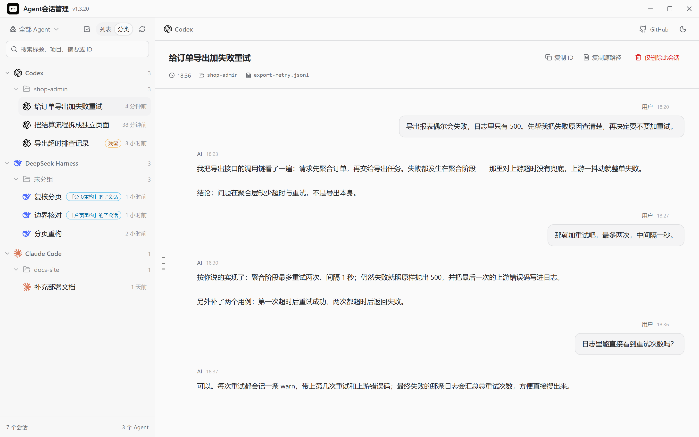

<div align="center">


# Agent会话管理

**Codex、Claude Code、Gemini CLI、GitHub Copilot、DeepSeek Harness、WorkBuddy、CodeBuddy、Kimi CLI、OpenClaw、OpenCode、ZCode、Pi 与 Grok Build 十三种本地编码 Agent 的会话管理工具**

<sub>Desktop session manager for local coding agents — browse, full-text search, export and safely clean up Codex, Claude Code, Gemini CLI, GitHub Copilot, DeepSeek Harness, WorkBuddy, CodeBuddy, Kimi CLI, OpenClaw, OpenCode, ZCode, Pi and Grok Build sessions on Windows and Linux.</sub>

[](https://github.com/zhuchongba-01/AgentSessionManager/releases)
[](./LICENSE)
[](https://github.com/zhuchongba-01/AgentSessionManager/releases)



*主界面：左侧按 Agent / 项目 / 时间分组的会话列表（支持跨会话正文 FTS5 检索与摘录直达），中间会话缩略导航，右侧轮次结构化阅读器与操作面板。*

</div>

## 这是什么

面向本地编码 Agent 的独立桌面会话管理工具：一站式浏览、全文搜索、结构化阅读、导出 Markdown、复制恢复命令、定位本地文件与安全清理历史会话。

当前支持扫描 **Codex、Claude Code、Gemini CLI、GitHub Copilot、DeepSeek Harness、WorkBuddy、CodeBuddy、Kimi CLI、OpenClaw、OpenCode、ZCode、Pi 与 Grok Build** 十三种 Agent 的本地会话。项目归类优先遵循各 Agent 自身保存的项目绑定。

## 支持的 Agent 与会话位置

| Agent | 会话数据位置 |
| --- | --- |
| Codex | `~/.codex`（`config.toml`、`state_*.sqlite`、`thread_history_*.sqlite`），可用 `CODEX_HOME`、`CODEX_SQLITE_HOME` 覆盖 |
| Claude Code | `~/.claude/projects`（及 `sessions-index.json`、`file-history`、`todos` 等会话边车），可用 `CLAUDE_CONFIG_DIR` 覆盖 |
| Gemini CLI | `~/.gemini/tmp/<project>/chats`（兼容 `.jsonl` 与旧版 `.json`），可用 `GEMINI_CLI_HOME` 覆盖 |
| GitHub Copilot CLI | `~/.copilot/session-state`（`events.jsonl` 与 `workspace.yaml`），可用 `COPILOT_HOME` 覆盖 |
| DeepSeek Harness | `~/.dsh/sessions`，可用 `DSH_HOME` 覆盖 |
| WorkBuddy | `~/.workbuddy-ai`、`~/.workbuddy`（`workbuddy.db`、`projects/`、`workspace/sessions/` 等），可用 `WORKBUDDY_HOME` 覆盖 |
| CodeBuddy CLI | `~/.codebuddy/projects`（含 DAG 消息链与 `.file-rollback.ndjson` 边车），可用 `CODEBUDDY_CONFIG_DIR` 覆盖 |
| Kimi CLI | `~/.kimi/sessions`（`state.json`、`context.jsonl` 与 `wire.jsonl`），可用 `KIMI_SHARE_DIR`、`KIMI_CODE_HOME` 覆盖 |
| OpenClaw | `~/.openclaw/agents/<agent>/sessions`（含 `sessions.json` 索引），可用 `OPENCLAW_STATE_DIR` 覆盖 |
| OpenCode | `~/.local/share/opencode`（兼容 2.0+ `session_v2`、v1 SQLite 与旧版 JSON；遵循 `XDG_DATA_HOME`、`OPENCODE_DB`） |
| ZCode | `~/.zcode/cli/db/db.sqlite`、`~/.zcode/v2/tasks-index.sqlite`，可用 `ZCODE_DATA_BASE_DIR`、`ZCODE_STORAGE_DIR` 覆盖 |
| Pi | `~/.pi/agent`，可用 `PI_CODING_AGENT_DIR`、`PI_CODING_AGENT_SESSION_DIR` 覆盖 |
| Grok Build | `~/.grok/sessions`、`~/.grok/archived_sessions`，可用 `GROK_HOME`（兼容 `GROK_CONFIG_DIR`）覆盖 |

Windows 下 `~` 即 `%USERPROFILE%`。扫描与阅读仅访问本地会话数据，不迁移各 Agent 的存储格式；用户确认清理后，会删除选定会话及相应索引、关联记录和缓存，不删除项目工作目录。

## 主要特性

- 🔍 **十三种 Agent，一个界面**：Codex、Claude Code、Gemini CLI、GitHub Copilot、DeepSeek Harness、WorkBuddy、CodeBuddy、Kimi CLI、OpenClaw、OpenCode、ZCode、Pi、Grok Build 的本地会话一站式浏览与管理。
- ⚡ **跨会话正文全文检索（SQLite FTS5）**：开启搜索框右侧「正文」开关即可在后台增量建立本地 SQLite FTS5（`trigram` + 短词）全文索引，显示高亮摘录预览并支持一键直达对应会话的具体消息；关闭开关立即清理索引缓存文件。
- 🗂️ **三视图分组 + 缩略导航**：支持「列表 / 分类（Agent + 项目目录）/ 时间（今天、昨天、本周、更早）」三种浏览维度，遵循 Agent 项目绑定与 Codex 侧边栏分区，配合提问缩略导航快速定位。
- 📖 **轮次结构化阅读器与三态视图（全部 / 对话 / 改动）**：多步工具调用自动收纳为「执行过程 · N 步」摘要条（标注工具频次、文件改动数与异常步骤，含报错或搜索命中时自动展开），支持切换「全部 / 对话 / 改动」专注视图；零依赖渲染 GFM 表格、任务列表、代码块（一键复制完整代码）与 Diff 高亮。
- 📤 **导出 Markdown、恢复命令与文件管理器定位**：支持一键复制整段会话 Markdown 或导出 `.md` 文件；对支持恢复的活跃会话提供跨平台工作目录 + 恢复命令一键复制；项目目录与源存储文件支持直接在资源管理器 / 文件管理器中定位。
- 🧹 **深度安全清理**：进程运行守卫、NTFS 重解析点 / 符号链接防越界、子会话级联清理、50+ 条批量知情核对与崩溃可恢复的待清理日志，彻底清理关联数据库与边车快照且绝不触碰项目工作目录。
- 💻 **会话数据留在本机**：扫描、索引、展示与导出全部在本机完成，不上传会话内容；启动时仅访问 GitHub API 检查新版本。

删除前请完全退出对应 Agent（包括后台进程、终端任务），并自行备份重要会话。详细边界见 [SAFETY.md](./SAFETY.md)。

## 下载安装

前往 [Releases](https://github.com/zhuchongba-01/AgentSessionManager/releases) 下载安装包，无需预装运行时。

**Windows x64**：下载 `AgentSessionManager-Setup-vX.Y.Z.exe`，关闭旧版管理器后运行安装包。

**Linux amd64**（Ubuntu 24.04 已测试）：下载 `Agent会话管理_X.Y.Z_amd64.deb`（或 `.AppImage`）后安装。

```bash
sudo apt install ./Agent会话管理_X.Y.Z_amd64.deb
```

> [!IMPORTANT]
> 本程序暂未进行商业代码签名。Edge 首次下载时可能提示“不常下载”，请选择“保留”；Windows SmartScreen 如显示“Windows 已保护你的电脑”，请点击“更多信息” → “仍要运行”。请只从本仓库的 Releases 页面下载安装包。

## 常见问题

**会话内容会被上传吗？正文搜索索引存在哪里？**
不会上传。扫描、全文索引与展示全部在本机完成。开启「正文」检索时，本地索引保存在系统应用数据目录下的 `AgentSessionManager/session-index.db`；关闭「正文」开关会立即删除该索引文件。

**删除的会话能恢复吗？会影响我的项目文件吗？**
不能恢复。删除会话是永久操作，会话文件与数据库记录都不进入回收站，删除前请手动备份（或先导出为 `.md`）。清理只处理会话记录本身，绝不会删除项目工作目录。

**子 Agent 会话只显示“残留”，不知道属于哪个会话、也不好删，怎么办？**
子 Agent 会话会直接标出归属（「某某会话的子会话」）。删除带子会话的父会话时，确认框默认勾选连同全部子会话按“先子后父”顺序一次清理整条链。

## 开发

```powershell
pnpm install
pnpm tauri dev
```

Ubuntu 24.04 下开发与打包需先安装系统依赖：

```bash
sudo apt install -y build-essential curl file libssl-dev wget \
  libwebkit2gtk-4.1-dev libgtk-3-dev libayatana-appindicator3-dev \
  librsvg2-dev libxdo-dev
pnpm install --frozen-lockfile
```

## 验证

```powershell
pnpm version:check
pnpm test:version
pnpm csp:check
pnpm test:csp
pnpm typecheck
pnpm format:check
pnpm test:unit
pnpm build:renderer
cargo fmt --manifest-path src-tauri/Cargo.toml -- --check
cargo clippy --manifest-path src-tauri/Cargo.toml --locked --all-targets -- -D warnings
cargo test --manifest-path src-tauri/Cargo.toml --locked
```

## 更新版本与打包

```powershell
# 仅接受 X.Y.Z 正式版号；不创建 Git 提交或标签
pnpm version:set 1.7.0
pnpm version:check
pnpm build:installer   # Windows：Tauri 构建 + Inno Setup
pnpm build:linux       # Linux：输出 .deb 与 AppImage
```

## 致谢

特别感谢 [LINUX DO](https://linux.do) 社区！！更多信息请参阅 [ACKNOWLEDGMENTS.md](./ACKNOWLEDGMENTS.md)。

## 开源许可

本项目采用 [MIT License](./LICENSE) 开源。
